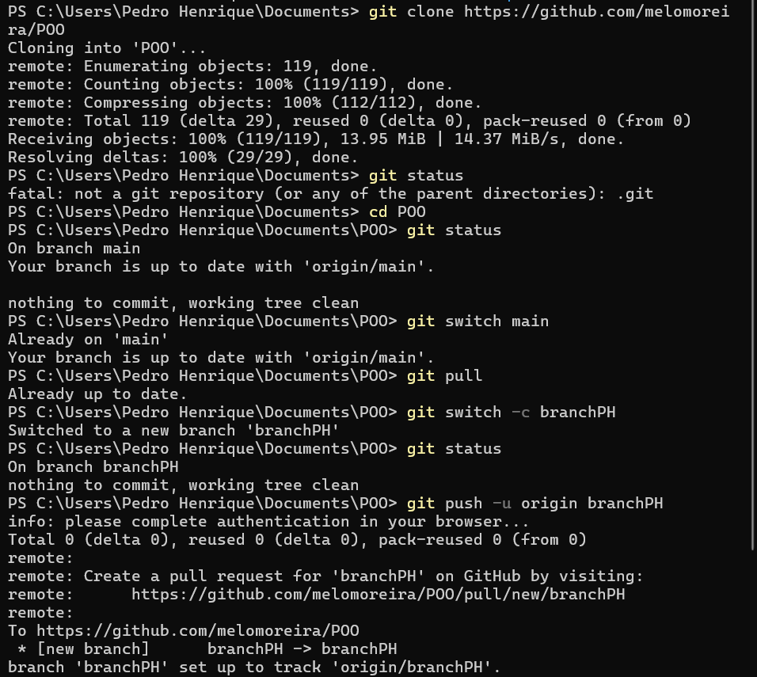
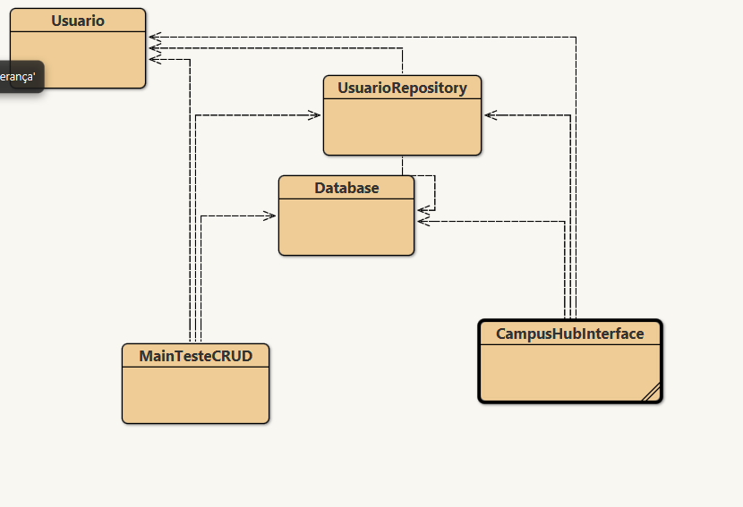
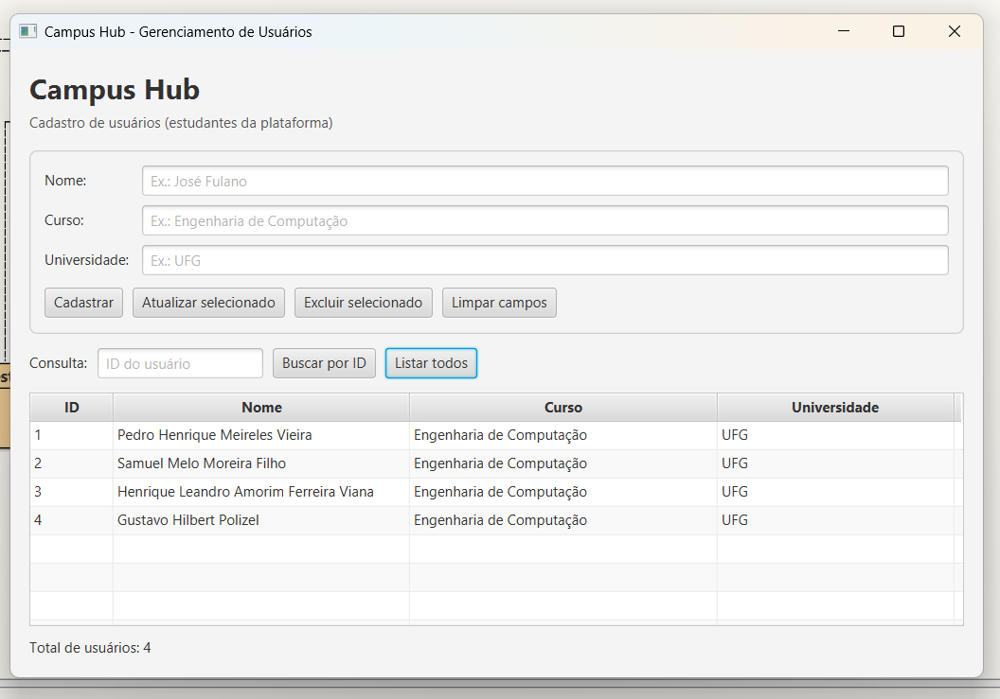
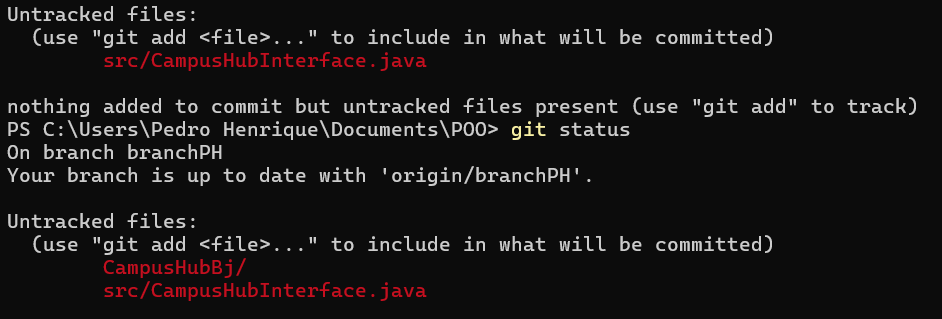
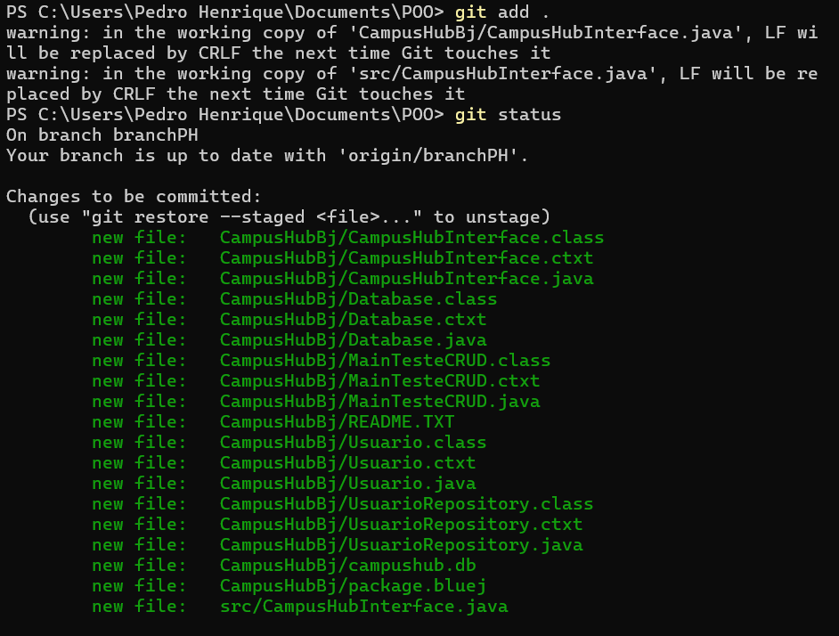
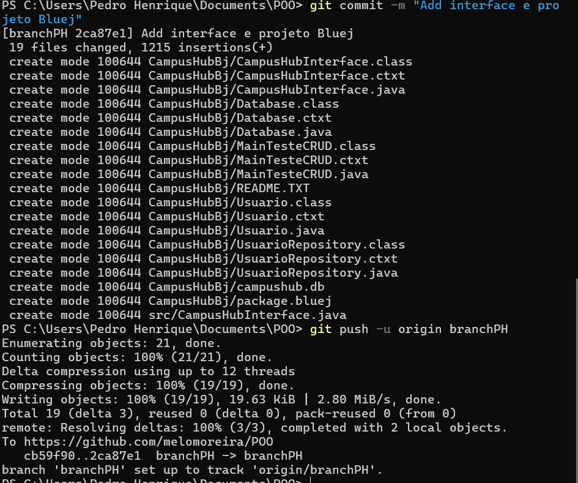

Entrega
## Primeiro passo: 
Criação de uma cópia local do nosso repositório por meio do git clone e criação da minha branch, "branchPH".

## Segundo passo:

Criação da classe CampusHubInterface, uma aplicação inicial JavaFX que demonstra visualmente o cadastro dos usuários ao informar nome, curso e universidade. Também possibilita a visualização dos usuários já cadastrados, busca por id e modificação de cadastros.

## Terceiro passo:

Adição (em branchPH ) da pasta do projeto atualizado do Bluej (CampusHubBj) e do CampusHubInterface.java na pasta src.

## Quarto passo:

Commit das alterações feitas em relação à Main com a mensagem "Add Interface e projeto Bluej" e envio ao GitHub com git push. 

